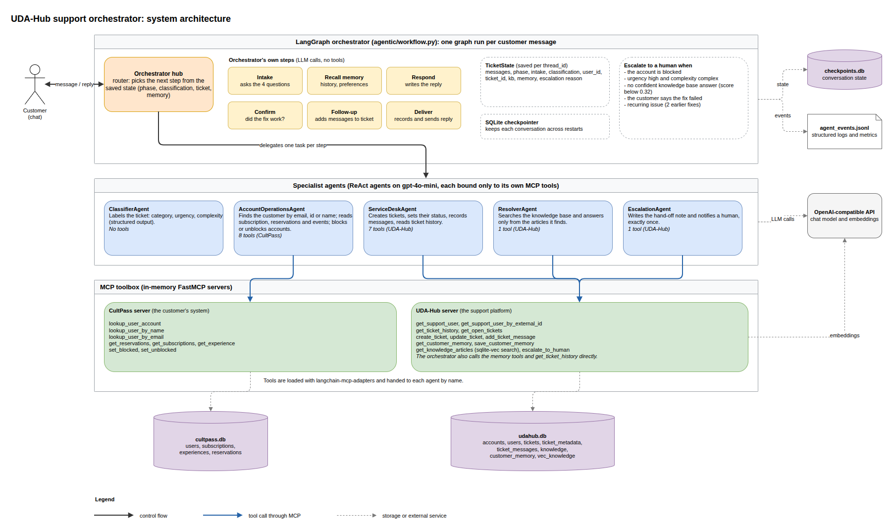
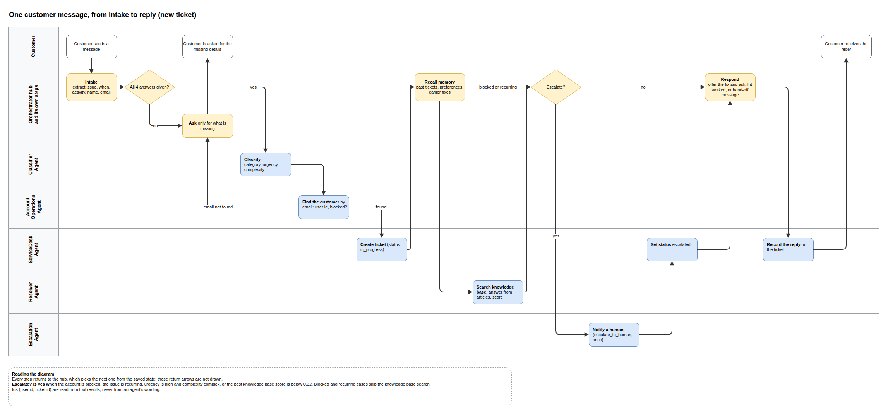
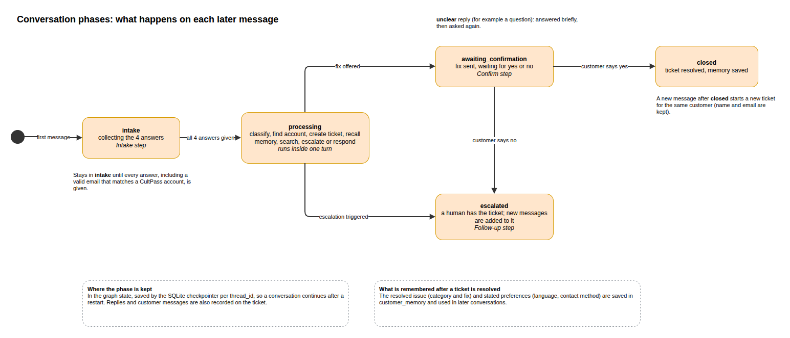

# UDA-Hub support orchestrator: architecture design

UDA-Hub resolves customer support tickets for a client company (here CultPass, a cultural experiences
subscription). A customer writes in natural language. The system asks for what it needs, classifies the
issue, finds the customer's account, opens a ticket, looks up what it already knows about the customer,
answers from the knowledge base or hands the ticket to a human, and remembers the outcome for next time.

The diagrams are drawn in draw.io. Source: [`architecture.drawio`](architecture.drawio) (three pages).

## 1. Pattern and rationale

**Pattern: supervisor (hub and spoke), with the supervisor written as a router in code.**
A LangGraph `StateGraph` has one hub node (`orchestrator`) and a set of spoke nodes. Every spoke reports back to
the hub, and the hub picks the next spoke from the saved state. Specialist agents sit behind the spokes, each with
its own prompt and its own tools.

Why this fits support tickets:

- The work has side effects (create a ticket, change its status, notify a human, block an account). The order of
  those steps must be reliable, so code decides the order and the language model decides only what needs judgement:
  classifying, searching, writing replies, and reading what the customer meant.
- Ids (`user_id`, `ticket_id`) are taken from tool results, never from an agent's wording, so an agent cannot
  invent a ticket that does not exist.
- Each agent has one job and only the tools for it, which keeps prompts short and limits what a mistake can touch.

Alternatives considered and rejected:

| Alternative | Why not |
|---|---|
| Supervisor chosen by a language model (`langgraph-supervisor`) | Tried first. The order of steps was right, but the service desk agent reported creating a ticket that was never created, the hand-off carries no task, and the tool results are hidden from the supervisor, so ids were lost. |
| Hierarchical (supervisors of supervisors) | Five specialists do not need a second management layer. |
| Network (agents call each other freely) | Hard to guarantee the order of steps and to test; more chances of loops. |

## 2. Diagrams

### System architecture



The orchestrator (top) holds the hub, its own steps, the saved state and the checkpointer. It delegates tasks to
the five specialist agents. The agents reach the data only through two in-memory MCP servers, one for the
customer's system (CultPass) and one for the support platform (UDA-Hub). Blue arrows are tool calls; dashed
arrows are storage or external services.

### Flow of one new ticket



Swimlanes show which component does each step, from the customer's first message to the reply. Every step
returns to the hub, which picks the next one; those return arrows are left out to keep the picture readable.

### Conversation phases



The graph runs once per customer message. The saved `phase` tells the hub what the new message means: more
intake answers, a yes or no to the fix, or a follow-up on an escalated ticket.

## 3. Agents

There are five specialist agents and one orchestrator. Agents are ReAct agents (`create_react_agent`) on
`gpt-4o-mini`. Their tools are bound by name in `agentic/agents/registry.py`; an agent never sees other tools.

| Agent | Responsibility | Inputs | Outputs | Tools |
|---|---|---|---|---|
| **ClassifierAgent** | Label the ticket | Issue, when, what the customer was doing | `Classification`: category (technical, billing, account, reservation, subscription, other), urgency (low, medium, high), complexity (simple, complex) | none |
| **AccountOperationsAgent** | Find the customer and read their account | Customer email | User id, name, blocked or not; subscription, reservations and events when asked | `lookup_user_account`, `lookup_user_by_name`, `lookup_user_by_email`, `get_reservations`, `get_subscriptions`, `get_experience`, `set_blocked`, `set_unblocked` |
| **ServiceDeskAgent** | Keep the ticket record | CultPass user id, name, message, tags; later: messages and status changes | `ticket_id` and what was done | `get_support_user`, `get_support_user_by_external_id`, `get_ticket_history`, `get_open_tickets`, `create_ticket`, `update_ticket`, `add_ticket_message` |
| **ResolverAgent** | Answer from the knowledge base | Issue, what the customer was doing, category | `Resolution`: `found_answer`, `answer`, `article_titles` | `get_knowledge_articles` |
| **EscalationAgent** | Hand the ticket to a human | Ticket id, issue, classification, search result, reason | A hand-off note and the human notification | `escalate_to_human` |

What each agent must not do:

- **ClassifierAgent** has no tools and does not look anything up; it labels only what the customer wrote.
- **AccountOperationsAgent** blocks or unblocks an account only when the task says to, never because a customer
  asked in conversation.
- **ServiceDeskAgent** always creates a new ticket unless told to reuse one, and ends every reply with the
  ticket id.
- **ResolverAgent** uses only the articles it finds. No outside knowledge, no promises of refunds or exceptions.
  A validator on `Resolution` discards any answer that cites no article, so ungrounded text cannot be sent on.
- **EscalationAgent** calls `escalate_to_human` exactly once and cannot change the ticket status (the service
  desk does that).

All agents share these rules: state only what a tool returned, claim an action only if the tool said `"ok": true`,
and copy ids exactly.

**The orchestrator hub and its own steps** are not agents. They are graph nodes that use the model directly or no
model at all:

| Step | What it does |
|---|---|
| Hub (`orchestrator`) | Reads the state and chooses the next step (`route`); logs the choice |
| Intake | Extracts issue, when, activity, name and email from the conversation; asks only for what is missing |
| Recall memory | Loads the customer's earlier resolved issues, preferences and ticket count; flags recurring issues |
| Respond | Writes the customer reply from the knowledge base answer, the customer's preferences and the outcome |
| Confirm | Reads the customer's yes, no or unclear after a fix; closes or escalates the ticket and saves memory |
| Follow-up | Adds later messages to an escalated ticket |
| Deliver | Records the reply on the ticket and sends it |

**Tools and data access.** 19 tools are exposed by two in-memory FastMCP servers and loaded with
`langchain-mcp-adapters`. Each tool returns `{"ok": true, ...}` or `{"ok": false, "error": <code>, "message": ...}`
and never raises; exception text is logged, not returned. The tools use repository classes, so no agent touches
SQL.

- CultPass server (8 tools, `cultpass.db`): user lookups by id, name and email; reservations; subscriptions;
  experiences; `set_blocked` and `set_unblocked`.
- UDA-Hub server (11 tools, `udahub.db`): support user and ticket lookups; `create_ticket`, `update_ticket`,
  `add_ticket_message`; `get_customer_memory`, `save_customer_memory`; `get_knowledge_articles`;
  `escalate_to_human` (a placeholder that reports "Human notified").

## 4. Shared state

The graph state (`TicketState`) is saved after every step under the conversation's `thread_id`.

| Field | Meaning | Written by |
|---|---|---|
| `messages` | The customer-facing conversation | Customer input; Deliver adds the replies |
| `history_start` | Where the current ticket's conversation begins in `messages` | Intake (when a closed ticket is followed by a new message) |
| `phase` | `intake`, `processing`, `awaiting_confirmation`, `escalated` or `closed` | Intake, Account lookup, Respond, Confirm |
| `intake` | issue, when, activity, name, email | Intake; Account lookup clears the email if it is unknown |
| `classification` | category, urgency, complexity | Classifier |
| `user_id`, `customer_name`, `account_blocked` | The CultPass customer | Account operations |
| `ticket_id`, `support_user_id` | The ticket and the support-side user, read from the `create_ticket` result | Service desk |
| `memory` | Earlier resolved issues, preferences, number of earlier tickets | Recall memory |
| `kb` | `found_answer`, `answer`, `article_titles`, `top_score` (the best score from the tool result) | Resolver; Confirm sets `found_answer` false when the fix failed |
| `escalation_reason`, `escalation_code` | Why a human takes over, as text and as a short code | Recall memory, Confirm, Escalate |
| `escalated` | A human has been notified | Escalate |
| `reply` | Text waiting to be sent | Any step with something to say; Deliver clears it |

## 5. Information flow and routing

### Step by step (new ticket)

1. **Hub, phase `intake`** → **Intake** extracts the four answers. If any is missing (including a valid email), it
   sets a reply asking only for those, and the turn ends.
2. **Classify.** The classifier returns category, urgency and complexity.
3. **Find the customer** by email. If no account matches, the email is cleared, the customer is asked to check
   it, and the turn ends. A blocked account is recorded.
4. **Create ticket** (status `in_progress`). The ticket id and the support user id come from the tool result.
5. **Recall memory.** Earlier resolved issues, preferences and ticket count are loaded. Two or more earlier
   resolved issues in the same category mean a recurring issue, which is escalated without a search.
6. **Resolve.** The resolver searches the knowledge base and answers from the articles it finds. The best
   similarity score is read from the tool result.
7. **Escalate?** (see the rules below). If yes, the escalation agent notifies a human and the service desk sets the
   ticket status to `escalated`.
8. **Respond** writes the reply: the fix and a question whether it worked, or a hand-off message.
9. **Deliver** records the reply on the ticket and sends it. The phase becomes `awaiting_confirmation` or
   `escalated`.

On the next message the hub reads the phase: **Confirm** (yes → ticket `resolved`, memory saved, `closed`;
no → escalate; unclear → answer briefly and ask again), **Follow-up** (adds the message to the escalated ticket),
or **Intake** (a closed ticket followed by a new message starts a new ticket for the same customer).

### Routing signals

| Signal | Source | Effect |
|---|---|---|
| Phase | Saved state | Chooses intake, confirm, follow-up or the processing pipeline |
| First missing piece of state | State | Chooses classify, then account lookup, then create ticket, then recall, then resolve |
| Account blocked | CultPass user record | Escalate, skip the search |
| Recurring issue (2 or more earlier fixes in the category) | Long-term memory | Escalate, skip the search |
| Customer says the fix failed | Confirm step | Escalate, skip the search |
| Urgency high and complexity complex | Classifier | Escalate, after the search (the customer still gets the knowledge base steps) |
| Knowledge base confidence below 0.32, or nothing found | Resolver and tool result | Escalate |

Ticket content and customer history drive the routing. The channel is fixed to chat in this version and ticket
date is not used.

### Confidence

The knowledge base is searched with vector similarity: each article (title, tags and content) is embedded with
`text-embedding-3-small`, stored in a `sqlite-vec` table in `udahub.db`, and the question is embedded and
compared by cosine distance. The score is `1 - distance`, clamped to 0 to 1. A search is confident when the
resolver found an answer and the best score is at least **0.32**. That value comes from a small sample (relevant
questions scored about 0.34 to 0.55, an off-topic one about 0.10) and should be re-measured on real tickets.

### Errors and edge cases

| Situation | Behaviour |
|---|---|
| Tool fails or is given bad input | The tool returns an error code; no exception reaches the model |
| A step raises an exception | It is logged, the customer is asked to resend, and the saved phase lets the next message resume the pipeline |
| Unknown email | The customer is asked to check it; intake asks only for the email |
| Nothing relevant in the knowledge base | Escalated; the reply gives no troubleshooting steps |
| Unclassifiable or off-topic ticket | Classified as `other`; usually ends up escalated |
| Memory cannot be read or written | Logged; the ticket carries on without it |
| Human notification fails | The customer is told to try again; it is retried on the next message |
| Duplicate notifications | The escalation agent is instructed to call the tool once |

## 6. Inputs and expected outputs by ticket type

Each row is a scripted scenario in `03_agentic_app.ipynb`, checked against the expected phase, ticket status,
escalation flag and reason code.

| Ticket type | Example | Route | Expected output |
|---|---|---|---|
| Simple FAQ | "How do I reserve a spot for an event?" | Classify, account, ticket, recall, resolve (confident), respond, confirm yes | Steps from the matching article; ticket `resolved`; phase `closed`; memory saved |
| Technical issue | "The app crashes whenever I open it" | Same as above | Fix steps from the app articles; ticket `resolved` |
| Urgent, complex problem | "I was charged twice and can't log in, my event is tomorrow" | Classified high and complex; resolve; escalate; respond | Steps plus a note that a human was notified; ticket `escalated`, reason `urgent_complex` |
| No knowledge base match | "Can I bring a pet to the workshop?" | Resolve finds nothing confident; escalate; respond | Apology and hand-off message with the ticket reference; reason `low_confidence` |
| Blocked account | Any issue from a blocked customer | Account lookup flags it; escalate (search skipped) | Hand-off message; reason `account_blocked` |
| Fix did not work | "No, it is still slow" after a fix | Confirm no; escalate | Hand-off message; reason `fix_failed` |
| Returning customer | A new conversation from a customer who asked for replies in another language | Recall finds preferences | The reply follows the preference |
| Recurring issue | Third technical problem from a customer with two earlier fixes | Recall flags it; escalate without a search | Hand-off message; reason `repeat_issue` |

## 7. Memory

| Kind | What it keeps | Where | Used for |
|---|---|---|---|
| Short-term | The conversation and all graph state for the current ticket | LangGraph state, keyed by `thread_id` | Continuing the same conversation across messages; inspecting a thread's messages and steps |
| Persistent | The same state across restarts | SQLite checkpointer, `data/core/checkpoints.db` (separate from `udahub.db`, so resetting the support database keeps conversations) | Resuming a conversation after the kernel restarts |
| Interaction history | Customer messages and bot replies | `ticket_messages` in `udahub.db` | Reading a ticket's thread; counting earlier tickets for returning customers |
| Long-term | Resolved issues (category and fix) and stated preferences (language, contact method) | `customer_memory` in `udahub.db` | Personalising replies; flagging recurring issues |

Long-term memory is written when the customer confirms a fix: the resolved issue is saved, and preferences are
extracted from what the customer wrote. It is read at the **Recall memory** step. It changes decisions in two
ways: the reply follows the customer's preferences and recognises an earlier similar problem, and two earlier
fixes in the same category send a returning problem to a human.

## 8. Logging and metrics

Every event is one JSON object per line in `logs/agent_events.jsonl`, with the conversation's `thread_id` and the
`ticket_id` when there is one:

```json
{"ts": "...", "level": "info", "event": "kb_retrieval", "thread_id": "...", "node": "resolve",
 "top_score": 0.56, "found_answer": true, "confident": true, "articles_used": 2}
```

| Events | What they record |
|---|---|
| `routing_decision`, `node_completed`, `node_failed` | The hub's choice for each step, step timing, failures |
| `intake_checked`, `classified`, `account_lookup`, `ticket_created` | Progress through the pipeline (labels and flags, not content) |
| `memory_recalled`, `memory_saved` | How much was recalled and saved |
| `kb_retrieval` | Best score, whether an answer was found, whether it was confident |
| `escalated`, `escalation_failed` | Escalations with a reason code: `account_blocked`, `urgent_complex`, `low_confidence`, `fix_failed`, `repeat_issue` |
| `reply_composed`, `confirmation`, `ticket_resolved`, `followup_recorded`, `turn_completed` | Outcomes |
| `tool_call`, `agent_run` | Every tool call with agent, tool and outcome (`ok`, `not_found`, `error`); agent timing |

**Sensitive data.** No message text, names, emails or free-text reasons are logged. Fields with sensitive names
are replaced by their length, and any email inside a string value is masked. Notebook 03 checks the log for every
sample customer's name and email.

**Metrics** (`summarize_logs()` in `agentic/observability.py`): knowledge base searches, confident searches and
success rate; tickets resolved against escalated, with escalation reasons; ticket categories; routing decisions;
tool usage by tool and by agent; average time per step; logged errors.

## 9. Where things are

| Path (under `solution/`) | Contents |
|---|---|
| `agentic/workflow.py` | The orchestrator graph: state, routing, steps |
| `agentic/agents/` | Agent definitions and `registry.py` (tool bindings) |
| `agentic/mcp_servers/` | MCP servers, repositories, knowledge index, toolbox |
| `agentic/checkpointing.py`, `agentic/observability.py`, `agentic/tool_results.py` | Persistence, logging and metrics, tool-result parsing |
| `data/models/` | SQLAlchemy models for both databases |
| `01_external_db_setup.ipynb`, `02_core_db_setup.ipynb`, `03_agentic_app.ipynb` | Database setup, knowledge base and index, the running system with its scenarios |

## 10. Known limits

- A full processing turn takes roughly 20 to 30 seconds because it makes several model calls.
- Replies are written by a model from the knowledge base text, so wording varies between runs.
- The escalation threshold (0.32) and the recurring-issue threshold (2) are set from small samples.
- One tenant (`cultpass`) is wired in; the data model is multi-tenant but the tools default to that account.
- `escalate_to_human` is a placeholder; it does not reach a real person yet.
